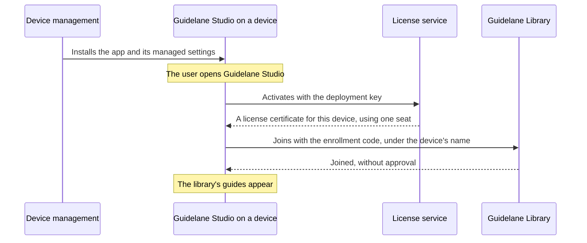

# Rolling out to managed devices

This guide is for companies that install Guidelane Studio on their devices with device
management, such as Jamf Pro, Microsoft Intune, Kandji or Group Policy. Once this is set up,
users who open Guidelane Studio for the first time find it already licensed and connected to the
company's library. Nobody has to enter anything or approve a request.

## How it works

You need two things: a **deployment key**, which licenses each device, and an **enrollment code**,
which lets each device join the server. Both go into Guidelane Studio's managed settings, which
your device management delivers together with the app.



The deployment key and the enrollment code are separate on purpose. The license is between your
company and Guidelane, and the server belongs to you. The server never sees the deployment key,
and the license service never sees your server or its guides.

## 1. Buy seats

Buy Business seats at `https://studio.guidelane.io/buy/business`. The purchase creates your
organization in the license portal at `https://studio.guidelane.io/license`. To sign in, use the
email address you paid with and the code sent to it. With a deployment key, one seat covers one
device. With a seat assigned by email, one seat covers one user on up to 3 of their devices.

## 2. Create a deployment key

In the license portal, open the Managed devices tab and choose "Create deployment key". The
portal shows the key only once, such as `GLS-7KQ4-M2XD-9PRT-HV3B`, so copy it right away.

Each device the key activates uses one free seat. If no seat is free, the next device stays
unlicensed until you buy more seats or free one up. The Managed devices tab lists every device the
key activated. To free a device's seat, choose "Remove…".

## 3. Create an enrollment code

On the server's admin page, open the Enrollment codes tab and choose "New enrollment code…".
Choose how many devices can join with the code and the day it expires. The page shows the code
only once, such as `K7QX-2M9P-CS3N-H4TR`.

## 4. Create the settings file

Next to the new enrollment code, the admin page offers two files that contain the server's
address and the code. Choose "Download for macOS" to save a configuration profile
(`.mobileconfig`), or "Download for Windows" to save a registry file (`.reg`).

To include the deployment key in the files, paste it under "Deployment key (optional)" before
you download them. Your browser adds the key to the file, and the key is never sent to the
server.

## 5. Deploy the app and the settings

**macOS**: Upload the configuration profile to your device management and scope it to the same
devices as the Guidelane Studio app. In Jamf Pro, upload it as a configuration profile. In
Microsoft Intune, add it as a custom configuration profile for macOS. In Kandji, add it as a
custom profile. The profile's preference domain is `io.guidelane.studio`.

**Windows**: Set the values under `HKEY_LOCAL_MACHINE\SOFTWARE\Policies\Guidelane\Studio`. You
can import the registry file with `reg import`, set the values with Group Policy Preferences, or
set them with a script from your device management. Guidelane Studio also reads the same values
under `HKEY_CURRENT_USER`, for policies set per user.

## 6. What users see

When a user opens Guidelane Studio for the first time:

- Settings shows the license as the organization's, without a "Deactivate" option.
- The server appears under Library as the organization's, without a "Leave" option.
- The device joins under its own name. If another device already has that name, a number is
  added, such as "MacBook Pro (2)".

The admin page lists every device that joined, and the license portal lists every device the
deployment key activated.

## Settings reference

| Setting | Description |
|---|---|
| `LibraryAddress` | The server to join, such as `library.example.com` or `library.example.com:7443`. |
| `LibraryEnrollmentCode` | An enrollment code. With it, the device joins immediately. Without it, Guidelane Studio sends a join request, which waits under "Join requests" on the admin page. |
| `LibraryFingerprint` | The fingerprint of the server's key, from the Server tab of the admin page. Guidelane Studio then only joins a server with that key. |
| `LicenseKey` | The deployment key. It activates the device the first time Guidelane Studio opens. |

All settings are optional. A profile with only `LicenseKey` licenses devices that join a server in
another way. A profile with only `LibraryAddress` and `LibraryEnrollmentCode` connects devices
that already have a license.

Guidelane Studio only reads these values when your device management sets them, so users can't
override them on their device.

A configuration profile written by hand looks like this. Generate your own two UUIDs with
`uuidgen`.

```xml
<?xml version="1.0" encoding="UTF-8"?>
<!DOCTYPE plist PUBLIC "-//Apple//DTD PLIST 1.0//EN" "http://www.apple.com/DTDs/PropertyList-1.0.dtd">
<plist version="1.0">
<dict>
  <key>PayloadContent</key>
  <array>
    <dict>
      <key>PayloadType</key>
      <string>io.guidelane.studio</string>
      <key>PayloadIdentifier</key>
      <string>com.example.guidelane-studio.settings</string>
      <key>PayloadUUID</key>
      <string>2F6B1C9E-6D4A-4C55-9E0B-4B8E5A4F7D21</string>
      <key>PayloadVersion</key>
      <integer>1</integer>
      <key>LibraryAddress</key>
      <string>library.example.com</string>
      <key>LibraryEnrollmentCode</key>
      <string>K7QX-2M9P-CS3N-H4TR</string>
      <key>LicenseKey</key>
      <string>GLS-7KQ4-M2XD-9PRT-HV3B</string>
    </dict>
  </array>
  <key>PayloadDisplayName</key>
  <string>Guidelane Studio</string>
  <key>PayloadIdentifier</key>
  <string>com.example.guidelane-studio</string>
  <key>PayloadType</key>
  <string>Configuration</string>
  <key>PayloadUUID</key>
  <string>9A3E7C52-1B8D-4F60-A2C4-7E5D3B1F9C08</string>
  <key>PayloadVersion</key>
  <integer>1</integer>
</dict>
</plist>
```

The same settings as a registry file:

```reg
Windows Registry Editor Version 5.00

[HKEY_LOCAL_MACHINE\SOFTWARE\Policies\Guidelane\Studio]
"LibraryAddress"="library.example.com"
"LibraryEnrollmentCode"="K7QX-2M9P-CS3N-H4TR"
"LicenseKey"="GLS-7KQ4-M2XD-9PRT-HV3B"
```

## Replacing devices and changing keys

- **A device is replaced or retired**: first remove it from the configuration profile's scope in
  your device management. Then remove it under Managed devices in the license portal to free its
  seat, and disconnect it on the Devices tab of the admin page so it can no longer connect to the
  server. A removed device loses its license the next time it goes online. As long as the profile
  still applies to the device, Guidelane Studio activates it again with the deployment key the
  next time it opens, and the device uses a seat again.
- **The deployment key is leaked**: choose "Create a new key…" under Managed devices. Devices
  that are already activated keep working. Add the new key to the profile for devices you add
  later.
- **The enrollment code is leaked or used up**: choose "Revoke…" on the Enrollment codes tab,
  create a new code and update the profile. Devices that joined with the old code stay connected.

## Unmanaged devices

Users on devices you don't manage get their own seat. In the license portal, open the Users tab,
enter the user's email address, and choose "Give a seat". The user receives a key by email that
works on up to 3 of their devices. They can join the server by finding it on the network, by
entering its address, or with a join link from "Invite a device" on the admin page.

## Who can read the settings

Anyone who uses a managed device can read its managed settings, including the enrollment code and
the deployment key. Both have limits that you set. An enrollment code only lets as many devices
join as you allowed, until the day you chose, and you can revoke it. A deployment key only
activates as many devices as you have free seats, and you can replace it.
