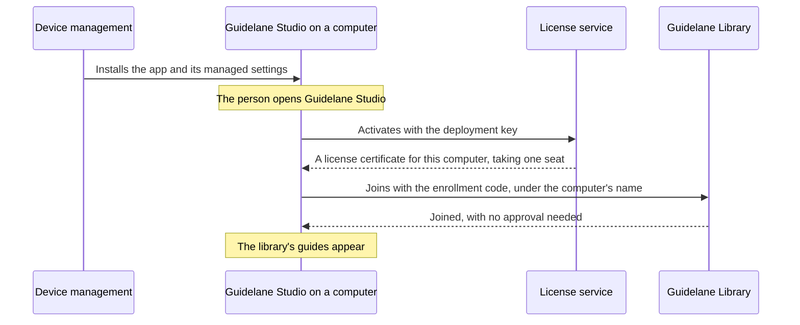

# Rolling out to managed devices

This guide is for a company that installs Guidelane Studio on its computers through device
management, such as Jamf Pro, Microsoft Intune, Kandji or Group Policy. When this is set up, a
person who opens Guidelane Studio for the first time finds it licensed and joined to the
company's library. Nobody has to type anything or approve a request.

## How it works

Two things make it work. A **deployment key** licenses each computer, and an **enrollment code**
lets each computer join the server. Both go into Guidelane Studio's managed settings, which your
device management delivers with the app.



The deployment key and the enrollment code are separate on purpose. The license is between
your company and Guidelane, and the server is yours. The server never sees the deployment key,
and the license service never sees your server or its guides.

## 1. Buy seats

Buy Business seats at `https://studio.guidelane.io/buy/business`. The purchase creates your
organisation in the license portal, `https://studio.guidelane.io/license`, where you sign in
with the email address you paid with and a code sent to it. With a deployment key, one seat
covers one computer. With a seat given by email, one seat covers one person on up to 3 of their
computers.

## 2. Create a deployment key

In the license portal, open the Managed devices tab and choose "Create deployment key". The
portal shows the key once, such as `GLS-7KQ4-M2XD-9PRT-HV3B`. Copy it then.

Each computer the key activates takes one free seat. When no seat is free, the next computer
stays unlicensed until you buy more seats or free one. The Managed devices tab lists every
computer the key activated. Choose "Remove…" to free a computer's seat.

## 3. Create an enrollment code

On the server's admin page, open the Enrollment codes tab and choose "New enrollment code…".
Choose how many computers the code may let join, and until which day. The page shows the code once,
such as `K7QX-2M9P-CS3N-H4TR`.

## 4. Create the settings file

Beside the new enrollment code, the admin page offers two files that hold the server's address
and the code. Choose "Download for macOS" to save a configuration profile (`.mobileconfig`), or
"Download for Windows" to save a registry file (`.reg`).

Paste the deployment key under "Deployment key (optional)" before you download the files, and
they include the key too. Your browser adds the key to the file, and the key is never sent to the
server.

## 5. Deliver the app and the settings

**macOS**: Upload the configuration profile to your device management and scope it to the same
computers as the Guidelane Studio app. In Jamf Pro, upload it as a configuration profile. In
Microsoft Intune, add it as a custom configuration profile for macOS. In Kandji, add it as a
custom profile. The profile's preference domain is `io.guidelane.studio`.

**Windows**: Set the values under `HKEY_LOCAL_MACHINE\SOFTWARE\Policies\Guidelane\Studio`. Import
the registry file with `reg import`, set the values with Group Policy Preferences, or set them
with a script from your device management. Guidelane Studio also reads the same values under
`HKEY_CURRENT_USER`, for a policy set for each user.

## 6. What people see

When a person opens Guidelane Studio for the first time:

- Settings shows the license as the organisation's, and "Deactivate" does not appear.
- The server appears under Library as the organisation's, and "Leave" does not appear.
- The computer joins under its own name. If another device has that name already, the name gets
  a number, as in "MacBook Pro (2)".

The admin page lists each computer that joined, and the license portal lists each computer the
deployment key activated.

## The settings

| Setting | What it does |
|---|---|
| `LibraryAddress` | The server to join, such as `library.example.com` or `library.example.com:7443`. |
| `LibraryEnrollmentCode` | An enrollment code. With it, the computer joins at once. Without it, Guidelane Studio asks to join, and the request waits under "Join requests" on the admin page. |
| `LibraryFingerprint` | The fingerprint of the server's key, from the admin page's Server tab. Guidelane Studio then joins only a server with that key. |
| `LicenseKey` | The deployment key. It activates the computer when Guidelane Studio first opens. |

Each setting is optional. A profile with `LicenseKey` alone licenses computers that join a
server some other way. A profile with `LibraryAddress` and `LibraryEnrollmentCode` alone joins
computers that already have a license.

Guidelane Studio reads a value only when your device management sets it, so a person cannot
replace it with a value of their own on the computer.

A configuration profile written by hand looks like this. Create your own two UUIDs with
`uuidgen`.

```xml
<?xml version="1.0" encoding="UTF-8"?>
<!DOCTYPE plist PUBLIC "-//Apple//DTD PLIST 1.0//EN" "http://www.apple.com/DTDs/PropertyList-1.0.dtd">
<plist version="1.0">
<dict>
  <key>PayloadContent</key>
  <array>
    <dict>
      <key>PayloadType</key>
      <string>io.guidelane.studio</string>
      <key>PayloadIdentifier</key>
      <string>com.example.guidelane-studio.settings</string>
      <key>PayloadUUID</key>
      <string>2F6B1C9E-6D4A-4C55-9E0B-4B8E5A4F7D21</string>
      <key>PayloadVersion</key>
      <integer>1</integer>
      <key>LibraryAddress</key>
      <string>library.example.com</string>
      <key>LibraryEnrollmentCode</key>
      <string>K7QX-2M9P-CS3N-H4TR</string>
      <key>LicenseKey</key>
      <string>GLS-7KQ4-M2XD-9PRT-HV3B</string>
    </dict>
  </array>
  <key>PayloadDisplayName</key>
  <string>Guidelane Studio</string>
  <key>PayloadIdentifier</key>
  <string>com.example.guidelane-studio</string>
  <key>PayloadType</key>
  <string>Configuration</string>
  <key>PayloadUUID</key>
  <string>9A3E7C52-1B8D-4F60-A2C4-7E5D3B1F9C08</string>
  <key>PayloadVersion</key>
  <integer>1</integer>
</dict>
</plist>
```

The same settings as a registry file:

```reg
Windows Registry Editor Version 5.00

[HKEY_LOCAL_MACHINE\SOFTWARE\Policies\Guidelane\Studio]
"LibraryAddress"="library.example.com"
"LibraryEnrollmentCode"="K7QX-2M9P-CS3N-H4TR"
"LicenseKey"="GLS-7KQ4-M2XD-9PRT-HV3B"
```

## When people come and go

- **A computer is replaced or retired**: first take it out of the configuration profile's scope
  in your device management. Then remove it under Managed devices in the license portal to free
  its seat, and disconnect it on the admin page's Devices tab so it can no longer reach the
  server. A removed computer loses its license the next time it is online. While the profile
  still applies to it, Guidelane Studio activates it again with the deployment key the next time
  it opens, and it takes a seat again.
- **The deployment key leaks**: choose "Create a new key…" under Managed devices. Computers that
  were activated keep working. Put the new key in the profile for computers that are added
  later.
- **The enrollment code leaks or runs out**: choose "Revoke…" on the Enrollment codes tab, create
  a new code and update the profile. Computers that joined with the old code stay joined.

## Computers that are not managed

People on computers you do not manage get a seat of their own. In the license portal, open the
Users tab, enter their email address, and choose "Give a seat". They receive a key by email that
works on up to 3 of their computers. They join the server by finding it on the network, by its
address, or with a join link from "Invite a device" on the admin page.

## Who can read the settings

Anyone who uses a managed computer can read its managed settings, the enrollment code and the
deployment key among them. Both have limits you set. An enrollment code lets only as many
computers join as you allowed, until the day you chose, and you can revoke it. A deployment key
activates only as many computers as you have free seats, and you can replace it.
